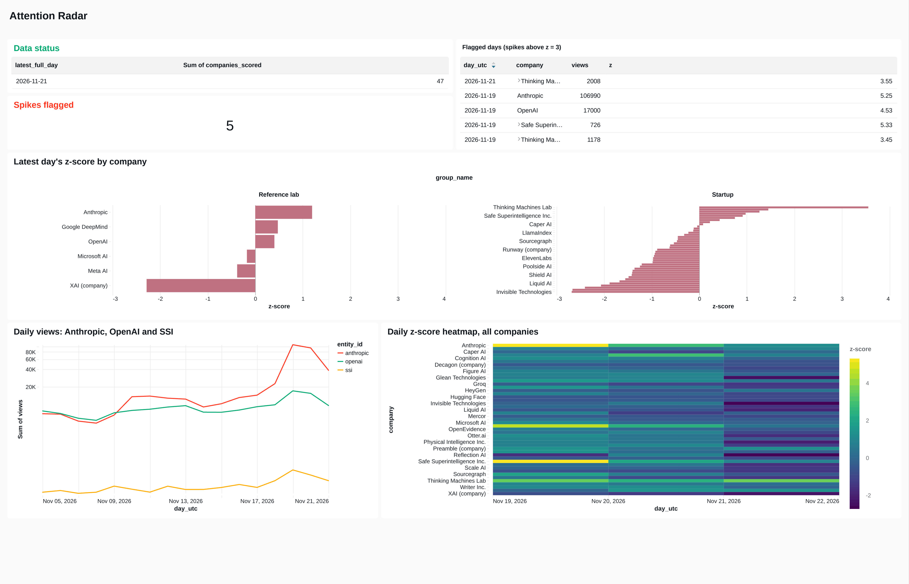
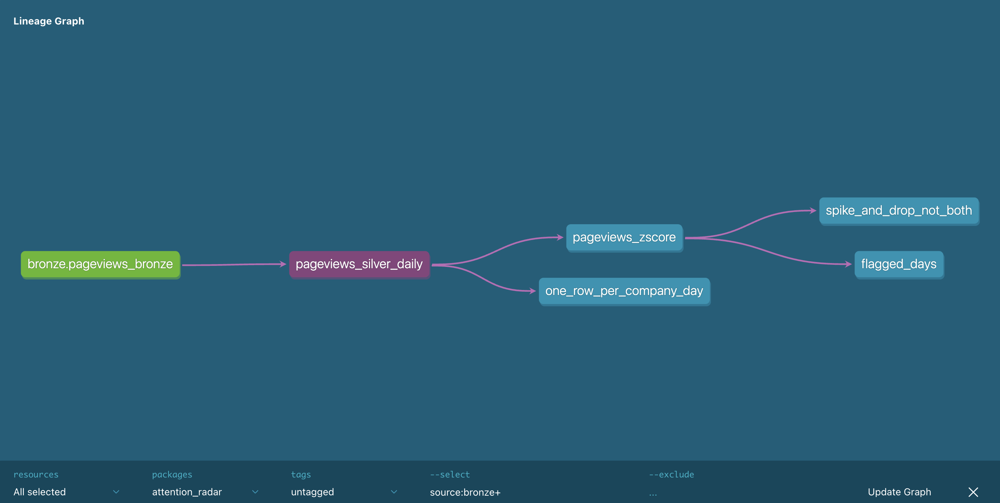

# Attention Radar: AI Startup Visibility from Wikipedia Pageviews

**Author:** Sagarika Raju

Attention Radar measures how much public attention AI startups receive on English
Wikipedia, hour by hour, and flags the moments when a company's traffic is unusually
high compared with its own recent history.

A startup can use it to see whether a launch, funding round, or announcement changed
how many people looked it up, and how that compares with its peers. Large AI labs are
tracked as reference labs, to show what high attention looks like on the same measure.

## The problem

AI startups compete for public attention, and that attention often follows specific
events: a product launch, a funding round, a leadership change, a partnership, or a
controversy. Wikipedia pageviews are a public, consistent proxy for interest. The
question this project answers is: **when did a company's attention rise above its own
normal level, and does that spike line up with something it did?**

## Who it is for

- **AI startups**, to check whether they are getting noticed and how they compare with
  peers.
- **Analysts and researchers**, tracking public attention on AI companies over time.
- **Communications teams**, watching for unusual visibility.

## Scope

**Main panel: US AI startups.** English Wikipedia articles for US-headquartered AI
startups. A company joins the panel only if it:

1. Works on AI as a core product or research focus.
2. Has an English Wikipedia article, with the exact title recorded in the seed file.
3. Is headquartered in the United States. This is checked against Wikipedia's category
   "Artificial intelligence industry in the United States." Companies outside that
   category are verified separately before they join.

The panel is not capped at a fixed size. It grows as companies meet the rule.

**Reference labs: large AI companies.** Anthropic, OpenAI, xAI, Google DeepMind, Meta AI,
and Microsoft AI. Reference labs are reported separately and are never ranked against
startups.

**Time range and limitation:** the data loaded so far starts on Nov 4, 2026 (about 19
days). Z-scores therefore use a short history, and the results should be read as an early
working version. The target is at least 12 months of history, so that rolling windows and
seasonal patterns have enough data to test against. A historical backfill is the next step.

The company list lives in `seeds/ai_companies.csv`, which is versioned so every change
is auditable.

## Data source

Wikimedia publishes a file for every hour, listing how many times each English
Wikipedia article was viewed in that hour. Each file covers all of Wikipedia, so the
pipeline keeps only the rows for panel companies.

Example file address:
`https://dumps.wikimedia.org/other/pageviews/2026/2026-11/pageviews-20261102-140000.gz`

Each run processes one hour, three hours behind the schedule, because Wikimedia
publishes each file a short while after the hour ends.

## How data is stored

| Layer | What it holds | Where |
|---|---|---|
| Bronze | Raw hourly rows for panel companies, unchanged from the source | Compressed CSV, one file per hour in S3, loaded into a Databricks table daily |
| Silver | One row per company per day, with total views | Databricks table, built by dbt |
| Gold | Daily baselines, z-scores, and spike flags | Databricks tables, built by dbt |

Bronze files are written atomically, and running the same hour twice produces the same file.

## How an anomaly is defined

- **Baseline:** each company's average and spread over the previous 30 days. Today is
  never part of its own baseline.
- **Minimum history:** at least 14 days of data, otherwise no score is given.
- **Transform:** the log version of the counts is used by default, because page view
  counts are highly uneven.
- **Flag:** a day is flagged as a spike when its z-score is above 3. Drops are computed
  but not kept in the flagged output.
- **No score** is given when the baseline has no spread, rather than dividing by zero.

## Dashboards

- **Databricks dashboard:** the full dashboard built in Databricks (Lakeview). It shows the
  data status, spike count, flagged days, daily views, the z-score chart and the heatmap.

  

- **Live Streamlit app:** the same results, reading the Databricks tables directly, so it
  updates as new data is loaded. Link: `https://ai-startups-attention-radar-hyf2ezfjgs9cfr6rcv54jv.streamlit.app/` 

## Architecture

```
Wikimedia hourly files (internet)
        │
        ▼
Airflow on AWS EC2 ──── schedules, retries, backfills
        │   (keeps only panel companies)
        ▼
Databricks: BRONZE → SILVER → GOLD (dbt)
   raw rows       clean rows     baselines, z-scores, flags
                                        │
                                        ▼
                    Dashboards (Databricks and Streamlit)

GitHub ── stores the code
```

## Transformations and tests (dbt)

dbt runs in Databricks after each daily load, in this order:

1. **Silver, `pageviews_silver_daily`:** adds up each company's hourly counts into one row
   per company per day. A day with no views gets 0, so quiet companies are still scored.
2. **Gold, `pageviews_zscore`:** scores each full day (all 24 hours observed) against the
   company's previous 30 days, using the log of the counts. It needs at least 14 prior
   days, and gives no score when the spread is zero.
3. **Gold, `flagged_days`:** keeps only the spikes (z above 3).

Tests run as part of `dbt build`:

- **Column tests:** the company, date and views columns must not be empty.
- **`one_row_per_company_day`:** each company has exactly one row per day in silver.
- **`spike_and_drop_not_both`:** no day is both a spike and a drop.

If a test fails, the daily Databricks job stops before the dashboard is updated.



The graph is generated by dbt. It shows which table is built from which, from bronze to silver to gold.

## Tech stack

- **Apache Airflow 3.3.2** (Docker Compose on AWS EC2, us-east-2): scheduling, retries,
  and backfills
- **AWS EC2**: an always-on Ubuntu server, so the pipeline runs when no laptop is open
- **Databricks** (free edition, Delta tables): storage and processing
- **dbt** (on Databricks): silver and gold models and tests, run daily by the Databricks job
- **Python**: parsing, filtering, and the anomaly calculation
- **Streamlit** (Streamlit Community Cloud): the live public dashboard, reading the Databricks tables
- **GitHub**: source control

## Repository layout

```
dags/                       Airflow DAG (hourly schedule)
src/pageviews_anomaly/      Core logic: parsing, filtering, z-score, seed loading
tests/                      Automated tests (32)
seeds/ai_companies.csv      Company panel and reference lab list
infra/airflow/              Notes on running Airflow on EC2
pyproject.toml              Project settings and test configuration
dashboard/                  Streamlit app for the live dashboard
```

## Running the tests

```bash
python3 -m venv .venv
source .venv/bin/activate
pip install pytest
pytest -q
```

Expected result: `32 passed`. The tests use small made-up examples. They don't
download data or connect to Airflow or Databricks.

## After December 1, 2026: the EC2 server is stopped

**Why.** Hourly ingestion runs on an AWS EC2 server that costs about $2 a day. The project
runs on AWS credits, and the server is stopped on December 1, 2026 so the project does not
keep running on personal money.

**What still works.** Everything loaded up to December 1 stays in place: the hourly files
in S3, the bronze, silver and gold tables in Databricks, and the dashboard. The dbt models
and tests run on the stored data. The dashboard shows data up to the last day loaded, and
it does not add new hours after December 1.

**What stops.** New hours are no longer downloaded from Wikimedia, so the Airflow DAG and
the daily Databricks load do not add new data.

**How to use the project after December 1:**

1. **Read the results.** See the Dashboards section above for the Databricks dashboard and
   the live Streamlit app.
2. **Run the tests without any cloud account.** `pytest -q` (see "Running the tests").
3. **Rebuild the pipeline on your own machine.** Airflow runs with Docker Compose (see
   `infra/airflow/`). It downloads the hourly files and writes them to S3, so it needs your
   own AWS bucket, and the bucket name is set with the `PAGEVIEWS_S3_BUCKET` setting.
4. **Run the dbt models on your own Databricks workspace.** The free edition is enough.
   Set `DATABRICKS_HOST`, `DATABRICKS_HTTP_PATH` and `DATABRICKS_TOKEN`, then run
   `dbt build` from the `dbt/` folder. The credentials stay in environment variables and
   are not stored in the repository.

**Ways to avoid a server cost.**

- **Run Airflow on your own computer** with Docker Compose. It costs nothing, but it only
  runs while the computer is on.
- **Schedule the ingest with GitHub Actions.** GitHub Actions is free for public
  repositories. A daily workflow could run the ingest script and write the new hours to S3.
  This is not built yet.
- **Use a free-tier scheduler.** A small free-tier VM or a scheduled job on another
  platform can run the same ingest script, with the same cost check first.

## Before the first backfill

1. Confirm every title in `seeds/ai_companies.csv` on Wikipedia, and set its
   `title_status` once checked.
2. Confirm the headquarters of each startup marked `not in category, verify HQ`.
3. Minimum-volume threshold: decided not to add one for now. Quiet articles are scored as they are.
4. Confirm that the EC2 server can download a Wikimedia file.

## Known limitations

- **Automated traffic:** the hourly files don't separate people from bots and crawlers,
  so some spikes may come from automated traffic.
- **Attention is not approval:** a spike can come from good or bad news. The pipeline
  measures attention, not sentiment.
- **Attribution is manual:** the pipeline flags spikes but does not explain them.
- **Flat history:** a company whose views have been exactly flat receives no score, so
  a jump from a flat baseline is not flagged yet.
- **Thin coverage:** many startups have few Wikipedia views, so their scores can move a lot
  on small changes. No minimum-volume rule is applied yet.
- **Titles and redirects:** renamed articles split their traffic. Titles are pinned in
  the seed file, and changes are recorded there.
